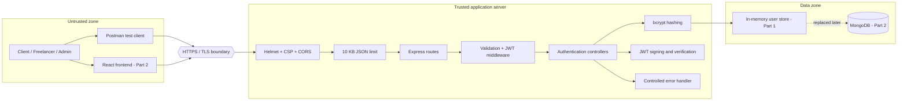
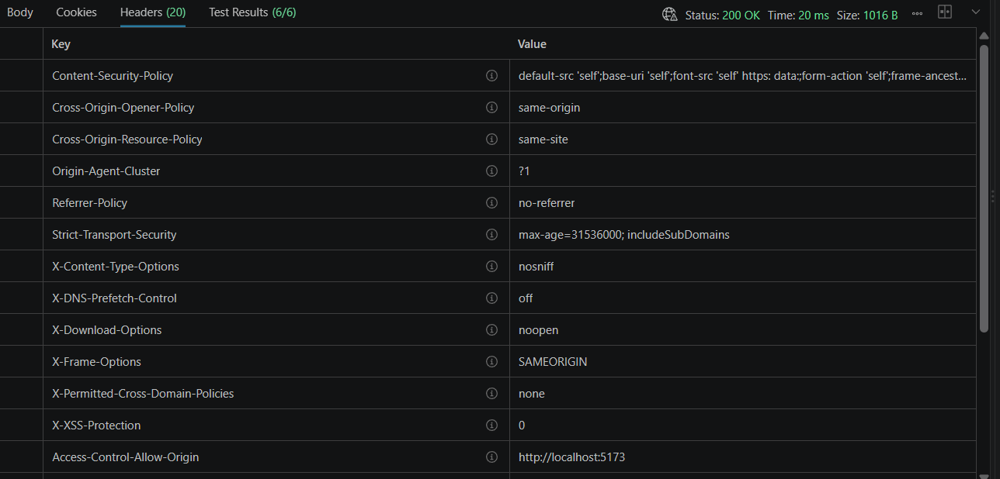
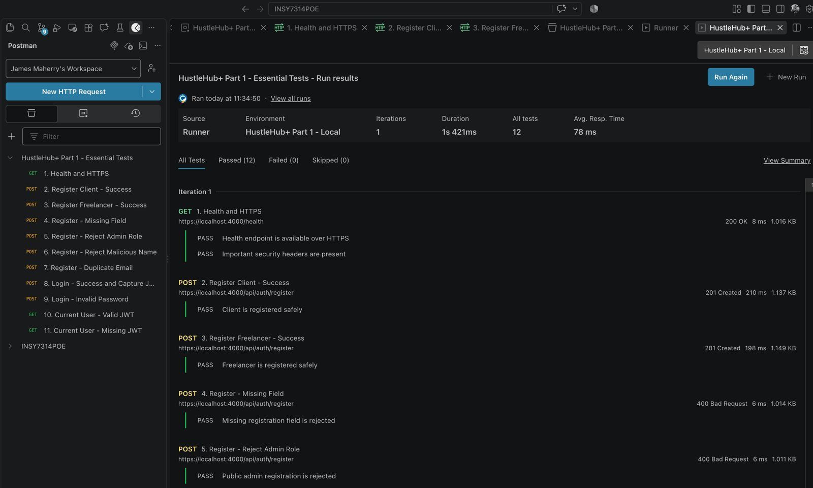
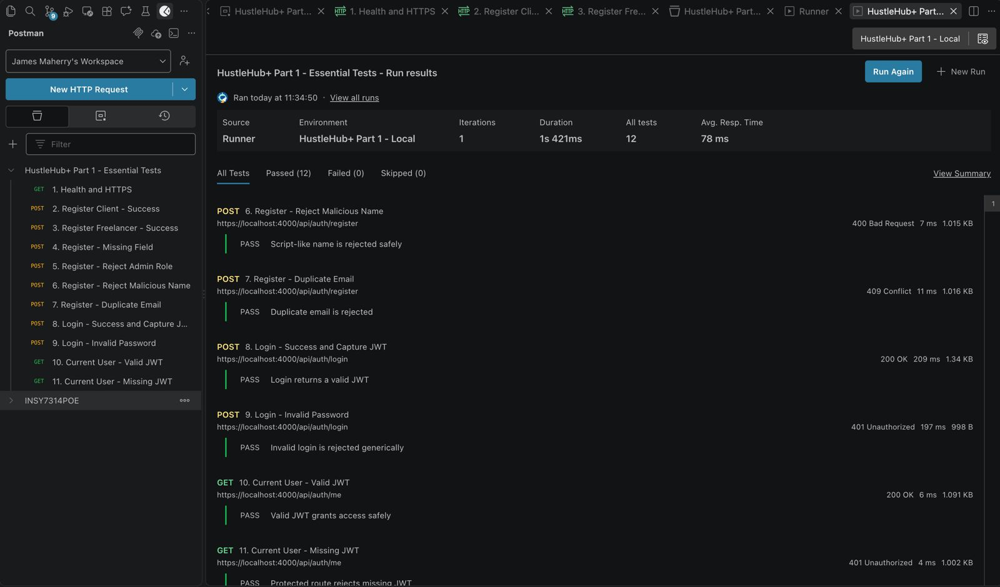

# HustleHub+

**INSY7314 Portfolio of Evidence - Part 1: Secure Foundations**

## Demonstration Video

[**Watch the HustleHub+ Part 1 demonstration on YouTube**](https://youtu.be/fm5UVAwE3pM)

## Group Members

| Group Member | Student Number | GitHub Username |
|---|---|---|
| James Maherry | ST10437403 | [ST10437403-JamesMaherry](https://github.com/ST10437403-JamesMaherry) |
| Ewald Pagel | ST10257942 | [ST10257942](https://github.com/ST10257942) |
| Mark Mansvelt | ST10438365 | [ST10438365MarkMansvelt](https://github.com/ST10438365MarkMansvelt) |

---

HustleHub+ is a secure freelance marketplace for clients, freelancers, and administrators. The completed platform will allow freelancers to advertise services, clients to make bookings, and the system to record transactions, income, and estimated tax.

Part 1 implements the secure backend foundation: an Express API with registration, login, password hashing, JWT authentication, HTTPS, input validation, security headers, and controlled error responses. MongoDB, the React frontend, marketplace features, RBAC, financial reporting, DevSecOps, and monitoring are introduced in later parts.

## Table of Contents

- [Demonstration Video](#demonstration-video)
- [Group Members](#group-members)
- [Architecture](#architecture)
- [Technology Stack](#technology-stack)
- [Project Structure](#project-structure)
- [API Endpoints](#api-endpoints)
- [Security Design](#security-design)
- [Installation and HTTPS Setup](#installation-and-https-setup)
- [Postman Testing](#postman-testing)
- [Screenshot Evidence](#screenshot-evidence)
- [Response Status Codes](#response-status-codes)
- [Part 1 Limitations and Part 2 Direction](#part-1-limitations-and-part-2-direction)
- [References](#references)

## Architecture



The main trust boundaries are:

| Boundary | Protection |
|---|---|
| Network | HTTPS encrypts credentials, tokens, and responses in transit. |
| Request | The body limit and validation middleware reject unsafe input before controller processing. |
| Identity | Protected routes verify the Bearer token's signature and expiry. |
| Storage | Only bcrypt password hashes are stored; plaintext passwords are never retained. |
| Response | Fixed client-safe errors prevent stack traces, paths, configuration, and secrets from leaking. |

See [`docs/architecture/hustlehub-architecture.md`](docs/architecture/hustlehub-architecture.md) for the detailed request flow and [`docs/architecture/hustlehub-architecture.mmd`](docs/architecture/hustlehub-architecture.mmd) for the editable diagram source.

## Technology Stack

- Node.js and Express 5
- JavaScript
- bcrypt for password hashing
- JSON Web Tokens through `jsonwebtoken`
- Helmet and Content Security Policy headers
- CORS allow-listing
- HTTPS using Node's built-in `https` module
- dotenv for local configuration
- Postman for endpoint testing
- An in-memory user store for Part 1

## Project Structure

```text
INSY7314POE/
|-- api/
|   |-- controllers/       Authentication workflows
|   |-- middleware/        Validation, JWT protection, and errors
|   |-- models/            Temporary in-memory user store
|   |-- routes/            Authentication routes
|   |-- utils/             bcrypt and JWT helpers
|   |-- .env.example       Safe configuration template
|   |-- index.js           Express and HTTPS entry point
|   `-- package.json
|-- docs/architecture/     Architecture documentation and diagram source
|-- evidence/part1/        Submission evidence
|   `-- screenshots/       Setup, authentication, security, and Postman screenshots
|-- postman/               Collection, environment, and import instructions
|-- .gitignore
`-- README.md
```

Local `.env`, certificate, private-key, dependency, and log files are excluded from Git.

## API Endpoints

| Method | Endpoint | Access | Purpose |
|---|---|---|---|
| `GET` | `/` | Public | Returns basic API information. |
| `GET` | `/health` | Public | Confirms availability and reports HTTP or HTTPS mode. |
| `POST` | `/api/auth/register` | Public | Registers a client or freelancer. |
| `POST` | `/api/auth/login` | Public | Verifies credentials and returns a signed JWT. |
| `GET` | `/api/auth/me` | Bearer JWT | Returns the authenticated user's safe profile. |

### Register

```json
{
  "fullName": "Test Client",
  "email": "client@example.com",
  "password": "Password123!",
  "role": "client"
}
```

Registration applies these rules before hashing or storage:

- All four fields are required and must be strings.
- Names are trimmed, limited to 2-80 characters, and checked for invalid or control characters.
- Emails are trimmed, converted to lowercase, limited to 254 characters, and format-checked.
- Passwords must contain 8-72 UTF-8 bytes and are not trimmed.
- Public roles are limited to `client` and `freelancer`; public `admin` registration is rejected.
- Unexpected properties are removed before the controller runs.
- Duplicate emails return `409 Conflict`.

A successful response contains the new UUID, full name, normalised email, and role. It never contains the password or password hash.

### Login

```json
{
  "email": "client@example.com",
  "password": "Password123!"
}
```

The email is normalised before lookup and the submitted password is compared with the stored bcrypt hash. Unknown users and incorrect passwords both return the generic response below to reduce account-enumeration information:

```json
{
  "error": "Invalid credentials"
}
```

Successful login returns safe user data and a signed JWT. The application-specific token claims are limited to the user's `id` and `role`; the library also adds issued-at and expiry timestamps.

### Protected Profile

Send the token returned by login as:

```text
Authorization: Bearer <token>
```

`GET /api/auth/me` verifies the token signature and expiry on every request, then returns the matching user's safe profile. Missing, malformed, invalid, tampered, and expired tokens are rejected with controlled responses.

## Security Design

### Password Storage

Passwords are hashed with bcrypt before storage and checked with bcrypt comparison during login. The work factor is configured through `BCRYPT_SALT_ROUNDS`; invalid or weak configuration falls back to 12 rounds. The 72-byte maximum is enforced because bcrypt implementations only process a limited input length. See the [OWASP Password Storage Cheat Sheet](https://cheatsheetseries.owasp.org/cheatsheets/Password_Storage_Cheat_Sheet.html).

### JWT Authentication

Tokens are signed using the server-only `JWT_SECRET` and expire according to `JWT_EXPIRES_IN`. JWTs are signed, not encrypted, so sensitive values are never placed in the payload. Protected routes trust claims only after verification. JWT structure is defined by [RFC 7519](https://www.rfc-editor.org/rfc/rfc7519.html).

### HTTPS and Headers

Normal Part 1 execution uses a locally generated self-signed certificate. Helmet adds browser security headers, including a restrictive Content Security Policy and Cross-Origin Resource Policy. Express's `X-Powered-By` header is disabled. Production must use a certificate issued by a trusted Certificate Authority or managed hosting platform.

### CORS and Request Limits

`CLIENT_ORIGIN` defines the browser origin permitted to read API responses. The current API advertises only `GET` and `POST`, with `Content-Type` and `Authorization` request headers. CORS is browser-enforced and does not replace authentication. JSON bodies are limited to `10kb`; oversized bodies receive a controlled `413` response.

### Error Handling

Unknown routes pass to a controlled `404` handler. Other forwarded failures reach the final four-argument Express error middleware, following Express's [error-handling model](https://expressjs.com/en/guide/error-handling/). Client responses use fixed safe messages, while diagnostic details remain in server logs. Responses never intentionally expose stack traces, filesystem paths, environment values, JWT secrets, certificates, or password hashes.

### Secret Management

The real `.env`, JWT secret, SSL key, and certificate remain local and must never be committed, pasted into documentation, or included in screenshots or Postman exports. Only `.env.example` belongs in source control.

## Installation and HTTPS Setup

Prerequisites: Node.js, npm, Git, OpenSSL, and Postman.

From the repository root:

```bash
cd api
npm install
cp .env.example .env
mkdir -p certs
```

Generate a JWT secret and place the result in the local `.env` file:

```bash
openssl rand -hex 32
```

Generate the local development certificate and private key:

```bash
openssl req -x509 -newkey rsa:2048 -nodes -sha256 -days 365 -keyout certs/localhost-key.pem -out certs/localhost-cert.pem -subj "/CN=localhost" -addext "subjectAltName=DNS:localhost,IP:127.0.0.1"
```

Git Bash users may need `//CN=localhost` for the subject to avoid path rewriting.

The local `.env` should contain:

```env
PORT=4000
APP_NAME=HustleHubPlusAPI
NODE_ENV=development
CLIENT_ORIGIN=http://localhost:5173
USE_HTTPS=true
SSL_KEY_PATH=./certs/localhost-key.pem
SSL_CERT_PATH=./certs/localhost-cert.pem
BCRYPT_SALT_ROUNDS=12
JWT_SECRET=replace_with_your_generated_secret
JWT_EXPIRES_IN=1h
```

Start the API:

```bash
npm start
```

Development mode uses:

```bash
npm run dev
```

The default address is `https://localhost:4000`. The certificate is self-signed, so a local browser or Postman may display a trust warning. HTTP is available only for troubleshooting by setting `USE_HTTPS=false`; the Part 1 demonstration should use HTTPS.

## Postman Testing

The [`postman`](postman/) folder contains:

- `HustleHubPlus-Part1.postman_collection.json`
- `HustleHubPlus-Local.postman_environment.json`
- Import and execution instructions in [`postman/README.md`](postman/README.md)

The concise collection contains 11 ordered requests covering:

- HTTPS health and security headers
- Successful client and freelancer registration
- Missing-field, forbidden-role, malicious-input, and duplicate-email failures
- Successful login and automatic JWT capture
- Generic invalid-login handling
- Protected access with and without a JWT

Select the supplied environment, temporarily disable Postman's SSL verification for this local self-signed certificate, and run the collection once in its existing order.

## Screenshot Evidence

The screenshots below are stored in [`evidence/part1/screenshots/`](evidence/part1/screenshots/) and referenced using paths relative to this repository-root README.

### Setup and HTTPS

**Fresh Clone Setup**


**HTTPS Health Check**


### Registration

**Successful Registration**


**Duplicate Registration**


### Login

**Successful Login**


**Failed Login**


### JWT Authentication

**Valid JWT**


**Invalid JWT**


### Input Validation and Request Limits

**Invalid Field Types**


**Malformed JSON**


**Oversized Request Body**


### CORS and Security Headers

**Allowed CORS Origin**


**Untrusted CORS Origin**


**Security Headers — Screenshot 1**



**Security Headers — Screenshot 2**


### Postman Collection

**Postman Collection — Screenshot 1**



**Postman Collection — Screenshot 2**



## Response Status Codes

| Status | Use |
|---|---|
| `200 OK` | Information, health, login, and authenticated profile responses. |
| `201 Created` | Successful user registration. |
| `400 Bad Request` | Invalid fields or malformed JSON. |
| `401 Unauthorized` | Invalid credentials or missing/invalid JWT. |
| `404 Not Found` | Unknown route. |
| `409 Conflict` | Duplicate email. |
| `413 Payload Too Large` | JSON body exceeds `10kb`. |
| `500 Internal Server Error` | Controlled unexpected server failure. |

## Part 1 Limitations and Part 2 Direction

The Part 1 user store is deliberately temporary: all accounts disappear whenever the API restarts. It is suitable only for demonstrating the secure authentication contract.

Part 2 will replace the store with MongoDB and Mongoose, add the React frontend, enforce full role-based access control, and implement gigs, bookings, simulated transactions, and freelancer income tracking. Later work also adds tax estimates, rate limiting, automated tests, Docker, CI/CD, static analysis, logging, and monitoring.

## References

- [OWASP Password Storage Cheat Sheet](https://cheatsheetseries.owasp.org/cheatsheets/Password_Storage_Cheat_Sheet.html)
- [RFC 7519 - JSON Web Token](https://www.rfc-editor.org/rfc/rfc7519.html)
- [Express error-handling guide](https://expressjs.com/en/guide/error-handling/)
- [Helmet documentation](https://helmetjs.github.io/)
