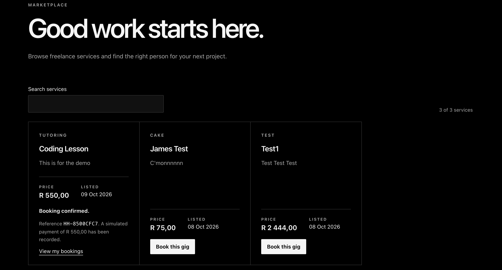
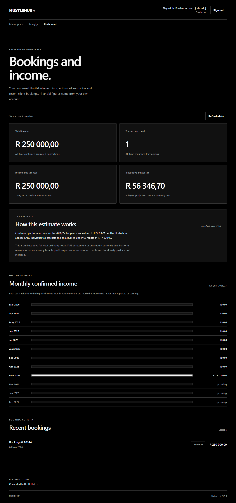
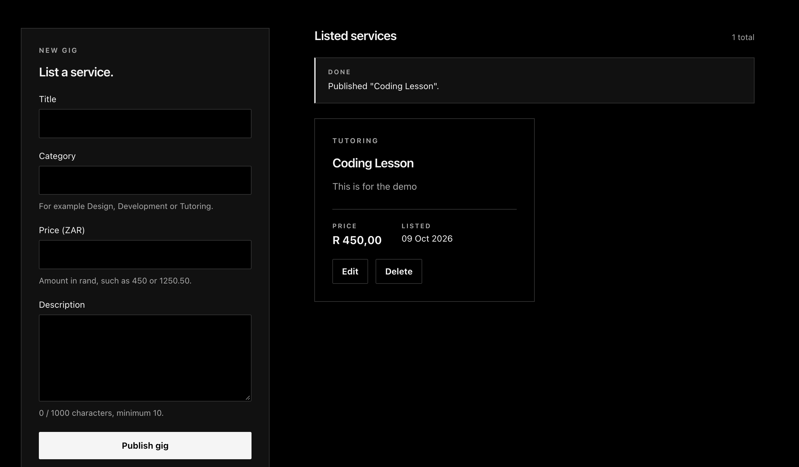
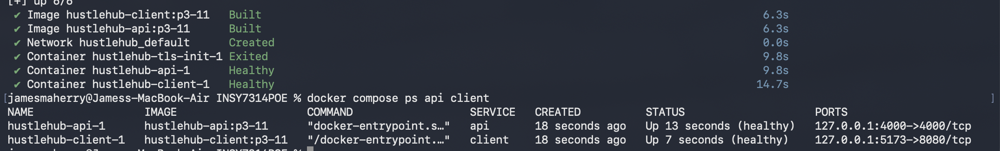
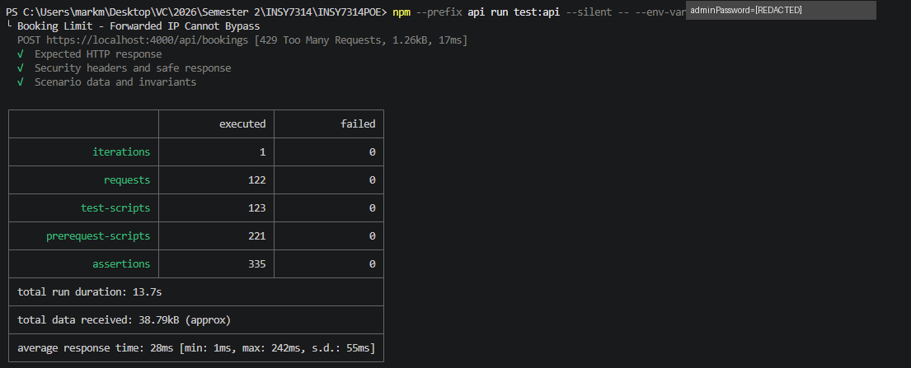

# HustleHub+

**Secure freelance marketplace · React · Express · MongoDB · DevSecOps**

HustleHub+ is a full-stack freelance marketplace where freelancers publish services, clients book them, and administrators oversee marketplace activity. The platform combines role-based access control, transactional booking records, financial reporting, security-focused API design, and an automated engineering pipeline.

The project began as a **collaborative group project** and is being continued as an independent portfolio and development project. The original collaboration remains represented in the Git history. This repository documents the working system, its engineering decisions, and the next steps toward a more mature product.

**Current scope:** Bookings record *simulated* payments, not real transfers of money. Income figures are based on those confirmed simulated transactions. The South African tax estimate is illustrative, uses the 2026/27 tax tables, and is not financial or tax advice.

**[Application demonstration](https://youtu.be/Xdnxl5pdQgw)** · **[Engineering playbook](HUSTLEHUB_PLAYBOOK.md)** · **[Architecture](docs/architecture/hustlehub-architecture.md)** · **[Security review](docs/security/threat-control-review.md)**

## What the platform does

| User | Capabilities | Server-side restrictions |
|---|---|---|
| Visitor | Browse active gigs; register and sign in | No booking, income, management, or administration access |
| Client | Search listings, confirm bookings, review booking history | Cannot manage gigs or access other clients' records |
| Freelancer | Publish, edit, activate, deactivate, and delete their gigs; review bookings and income | Cannot edit another freelancer's gigs or view another freelancer's income |
| Administrator | Review users and bookings; remove gigs | Verified administrator role required; registration cannot assign this role |

### Marketplace workflow

1. A freelancer registers and publishes a gig with a server-validated price.
2. A client browses listings and confirms a booking.
3. The API creates the booking and matching simulated transaction inside one MongoDB transaction.
4. The client can see the confirmed booking in their history.
5. The freelancer sees confirmed income, a monthly breakdown, and an illustrative tax projection.

### Application previews

<details open>
<summary>Marketplace and booking</summary>

**Active service marketplace**


**Client booking confirmation**



</details>

<details open>
<summary>Freelancer income dashboard</summary>



</details>

The screenshots capture the implementation at the time of testing; financial projections depend on the date of the calculation. The [demonstration video](https://youtu.be/Xdnxl5pdQgw) covers the broader workflow.

## Engineering highlights

### Authentication and authorisation

- Passwords are stored as bcrypt hashes. Authentication issues signed, expiring JWTs.
- Protected routes verify the token and reload the user's current role and session version from MongoDB.
- Signing out atomically increments the stored session version, invalidating previously issued tokens.
- Role checks and resource ownership are enforced by the API rather than relying on React route guards.
- Public registration permits only client and freelancer roles; administrator access is provisioned separately.

See [session revocation](docs/security/session-revocation.md) and the [security review](docs/security/threat-control-review.md).

### Booking integrity and transaction records

- Booking requests require an `Idempotency-Key` containing a UUID v4.
- Retrying the same key and gig returns the original result (`200`, `replayed: true`) instead of charging or recording twice.
- Reusing a key for a different gig is rejected with `409 Conflict`.
- A database unique index and MongoDB session transaction preserve booking/transaction consistency.
- The amount and ownership are derived on the server from the authenticated user and the stored gig; client-supplied amounts are not trusted.

Payments are simulated; there is no real payment gateway. See [booking replay protection](docs/security/booking-idempotency.md).

### Income reporting and illustrative tax

- Lifetime and year-to-date income are calculated from confirmed transaction records belonging to the authenticated freelancer.
- The dashboard presents a March–February monthly breakdown aligned to the South African tax year.
- The API annualises year-to-date income and applies the documented **2026/27 SARS brackets and primary rebate**.
- The result is a modelled annual estimate, not a tax liability determination; other income, deductions, and individual circumstances are outside the calculation.

See the [calculation methodology](docs/finance/tax-estimation.md) and [income API contract](docs/finance/income-api-contract.md). Tax tables must be reviewed before using this feature for another tax year.

### Secure API boundaries

Express applies Helmet security headers, restricted CORS, bounded JSON bodies, field allowlists, validation and sanitisation, centralised error handling, and separate authentication, registration, and booking rate limiters. Controllers check resource ownership before reading or mutating protected records. Unexpected errors return controlled responses rather than internal diagnostics.

The browser uses `sessionStorage` for its JWT. This is an explicit security trade-off; see [known limitations](#known-limitations-and-next-steps).

### Structured events and monitoring

The API writes structured Winston JSON events for authentication outcomes, bookings, transaction commits, start-up, and errors. Records use server-generated request IDs and an allowlist of safe fields. Optional Grafana Cloud Loki delivery uses a write-only access token. With Grafana unset, logging continues to stdout.

[Event contract](docs/monitoring/structured-events.md) · [Grafana configuration](docs/monitoring/grafana-cloud.md) · [Dashboard definition](docs/monitoring/grafana-dashboard.json)

## Architecture and technology

```text
Browser (React / Vite)
   |
   | HTTPS API requests / JWT
   v
Express API (Node.js)
   |-- Authentication and server-side session revocation
   |-- Roles, ownership, validation, rate limits
   |-- Gigs and idempotent bookings
   |-- Income analytics and tax projection
   |-- Structured event logging ----> Grafana Cloud Loki (optional)
   |
   v
MongoDB Atlas (Mongoose; transactional booking records)

Docker Compose: non-root API + non-root Nginx client + TLS initializer
GitHub Actions: tests + builds + dependency audits + Docker integration + Sonar
```

| Layer | Main technologies |
|---|---|
| Frontend | React, React Router, Vite, JavaScript, CSS |
| Backend | Node.js, Express 5, Mongoose |
| Database | MongoDB Atlas |
| Identity | bcrypt, JWT, server-side session versions |
| Security | Helmet, CORS, validation, sanitisation, rate limiting, idempotency keys |
| Monitoring | Winston, Grafana Cloud Loki (optional) |
| Containers | Docker, Nginx, Docker Compose |
| CI / analysis | GitHub Actions, `npm audit`, SonarQube Cloud |
| Testing | Node.js test runner, Vitest, React Testing Library, Postman CLI, Playwright |

The React client never connects to MongoDB directly. Authentication, prices, financial records, and administrator permissions are controlled by the API.

**Further reading:** [architecture and trust boundaries](docs/architecture/hustlehub-architecture.md) · [diagram source](docs/architecture/hustlehub-architecture.mmd) · [threat-to-control review](docs/security/threat-control-review.md).

## Getting started

### Requirements

- Node.js 22+ and npm (the frontend CI build uses Node.js 24).
- MongoDB Atlas access, including valid credentials and an appropriate IP access-list entry.
- Docker Desktop for the containerised workflow.
- OpenSSL for local HTTPS certificates.

Copy the repository's HTTPS clone URL from GitHub, then:

```bash
# Replace the placeholder with this repository's actual clone URL.
git clone <repository-clone-url> HustleHub-Plus
cd HustleHub-Plus
```

Use the committed lockfiles to install dependencies. The **root `.env` is used for Docker Compose**, whereas `api/.env` and `client/.env` are used by the native development servers. These files are intentionally excluded from Git.

### Option A — Docker Compose

From the repository root:

```bash
cp .env.example .env
open -e .env

# Docker Desktop must be running; .env must contain your own Atlas MONGO_URI and JWT_SECRET.
docker compose config --quiet
docker compose up --build -d --wait
docker compose ps api client
```

Keep these browser-facing addresses in the root `.env`:

```dotenv
CLIENT_ORIGIN=http://localhost:5173
VITE_API_URL=https://localhost:4000
```

After startup:

- Frontend: `http://localhost:5173`
- API: `https://localhost:4000`
- API health: `https://localhost:4000/health`

The API uses a locally generated, self-signed HTTPS certificate. Export and verify its **public** certificate:

```bash
mkdir -p api/certs
docker compose cp api:/app/certs/localhost-cert.pem api/certs/compose-localhost-cert.pem
curl --fail --cacert api/certs/compose-localhost-cert.pem https://localhost:4000/health
curl --fail --silent --show-error -o /dev/null -w 'Frontend HTTP %{http_code}\n' http://localhost:5173/login
```

Trust the public certificate locally in macOS Keychain Access or your operating system's certificate store before signing in through the browser. Never disable TLS verification globally or share the private key. The [Compose guide](docs/docker/compose.md) includes a full explanation and the disposable integration stack.

Stop the normal stack with:

```bash
docker compose down
```

Do not use `--volumes` for the ordinary stack unless you deliberately want to regenerate its certificate.

### Option B — Native development servers

```bash
npm --prefix api ci
npm --prefix client ci
cp api/.env.example api/.env
cp client/.env.example client/.env
mkdir -p api/certs

# Generate a signing secret and place it in api/.env, together with your own MONGO_URI.
openssl rand -hex 32

# Create a local self-signed certificate for the HTTPS API.
openssl req -x509 -newkey rsa:2048 -nodes -sha256 -days 365 \
  -keyout api/certs/localhost-key.pem \
  -out api/certs/localhost-cert.pem \
  -subj "/CN=localhost" \
  -addext "subjectAltName=DNS:localhost,IP:127.0.0.1"
```

In separate terminals from the repository root:

```bash
npm --prefix api start
```

```bash
npm --prefix client run dev
```

Set `VITE_API_URL=https://localhost:4000` in `client/.env` and `CLIENT_ORIGIN=http://localhost:5173` in `api/.env`. Trust the local public certificate in your browser before testing authenticated requests.

### Administrator setup

Public registration does not grant the administrator role. For a **local or controlled test database**, register an account normally, then change that account's `role` from `client` to `admin` in the MongoDB `users` collection, retaining its password hash. Sign in again after the role change. Do not expose administrator provisioning as a public endpoint.

An administrator password appeared in the repository's older Git history. Treat that historical credential as compromised and rotate it wherever it is still valid. New installations should use independent credentials.

## API reference

All API routes use `https://localhost:4000` by default.

| Method | Route | Access | Purpose |
|---|---|---|---|
| `GET` | `/health` | Public | HTTPS and application health |
| `POST` | `/api/auth/register` | Public | Client/freelancer registration |
| `POST` | `/api/auth/login` | Public | Issue an authenticated session |
| `GET` | `/api/auth/me` | JWT | Read the signed-in user's safe profile |
| `POST` | `/api/auth/logout` | JWT | Revoke active sessions for the account |
| `GET` | `/api/gigs` | Public | Browse active gigs |
| `GET` | `/api/gigs/:id` | Public | View one active gig |
| `GET` | `/api/gigs/mine` | Freelancer | Read own listings |
| `POST` | `/api/gigs` | Freelancer | Publish a gig |
| `PUT` | `/api/gigs/:id` | Owning freelancer | Edit a gig |
| `DELETE` | `/api/gigs/:id` | Owning freelancer | Remove a gig |
| `POST` | `/api/bookings` | Client | Book a gig and record simulated transaction |
| `GET` | `/api/bookings/mine` | Client | Read own booking history |
| `GET` | `/api/bookings/freelancer` | Freelancer | Read bookings received |
| `GET` | `/api/bookings/:id` | Owning client | Read one booking |
| `GET` | `/api/income/me` | Freelancer | Income, monthly reporting, illustrative tax |
| `GET` | `/api/admin/users` | Administrator | Safe user listing |
| `GET` | `/api/admin/bookings` | Administrator | Platform booking view |
| `DELETE` | `/api/admin/gigs/:id` | Administrator | Moderate a gig |

Protected endpoints require `Authorization: Bearer <token>`. Booking creation also requires `Idempotency-Key: <uuid-v4>` and a JSON body containing the selected `gigId`. See [Postman tests](postman/README.md) and [income response contract](docs/finance/income-api-contract.md) for full request/response verification.

## Tests and DevSecOps

### Local checks

Run these independently from the repository root:

```bash
npm --prefix api test
npm --prefix api run test:coverage
npm --prefix client test
npm --prefix client run test:coverage
npm --prefix client run lint
npm --prefix client run build
```

**Integration testing:** The Postman functional/security suites exercise live HTTPS endpoints and a real database; Playwright drives the real browser journey. They generate fresh users, and API rate limiters are in memory, so each full suite needs a fresh API process. Prefer the repository's disposable Docker integration stack rather than creating test data in a long-lived Atlas database.

- [Functional API collection and runner instructions](postman/README.md)
- [Browser end-to-end tests](docs/testing/e2e-playwright.md)
- [Security regression suite](docs/testing/security-postman-suite.md)
- [Docker integration guide](docs/docker/compose.md)

### CI workflow

[`.github/workflows/ci.yml`](.github/workflows/ci.yml) defines independent jobs for configuration contracts, backend coverage, frontend tests/lint/build, dependency audits, five isolated Docker integration suites, and SonarQube Cloud analysis. A final `CI gate` evaluates the required results and fails when an essential check fails.

**Personal-repository migration is not yet complete:** The imported workflow's Sonar job is scoped to the former development branch (`dev`), and its Sonar project configuration still points at an externally managed organisation. On the personal repository's `main`, the Sonar job is currently skipped by design. **A green `main` workflow is not proof of a passing Sonar quality gate** until both the repository's Sonar settings and main-branch workflow conditions are updated and a real scan passes. The [engineering playbook](HUSTLEHUB_PLAYBOOK.md#personal-service-ownership) lists the exact migration work.

CI uses disposable MongoDB and generated test secrets; it does not need a production Atlas URI. GitHub Actions repository secrets do not travel with a Git push.

## Engineering evidence

The existing evidence is retained as historical verification of the implementation. It remains linked under its original directory names to preserve working paths.

| Area | Source / design | Verification |
|---|---|---|
| Marketplace and transactions | [Gig controller](api/controllers/gigController.js), [booking controller](api/controllers/bookingController.js) | [Booking screenshot](evidence/part2/bookings/booking-confirmed.png), [persistence](evidence/part2/database/transaction-record.png) |
| Financial reporting | [Tax estimator](api/services/taxEstimator.js), [income analytics](api/services/incomeAnalytics.js) | [Dashboard](evidence/part3/e2e/screenshots/05-freelancer-income-tax-dashboard.png), [financial assertions](evidence/part3/newman/financial-assertions.png) |
| Authentication and access | [Session design](docs/security/session-revocation.md), [threat review](docs/security/threat-control-review.md) | [Security reports](evidence/part3/security-tests/), [access denial](evidence/part3/e2e/screenshots/07-client-access-denied.png) |
| Automated integration | [CI workflow](.github/workflows/ci.yml), [CI guide](docs/ci/devsecops.md) | [Historic workflow runs](evidence/part3/ci/github-actions-runs.png), [Playwright report](evidence/part3/e2e/playwright-junit.xml) |
| Static analysis | [Analysis configuration](sonar-project.properties), [findings](docs/security/static-analysis.md) | [Static analysis evidence](evidence/part3/static-analysis/) |
| Containers | [Compose configuration](compose.yaml), [Docker guide](docs/docker/compose.md) | [Healthy containers](evidence/part3/docker/compose-ps.png), [HTTPS and frontend](evidence/part3/docker/api-https-health.png) |
| Observability | [Structured events](docs/monitoring/structured-events.md) | [Grafana evidence](evidence/part3/logging/) |

<details>
<summary>Additional application and test screenshots</summary>

**Freelancer gig management**



**Booking history**


**Administrator overview**


**Docker health**



**Automated API tests**



</details>

The detailed [evidence index](evidence/part3/README.md) and historical test reports remain available. They reflect specific runs, not a guarantee that all checks have already passed on the new personal GitHub repository.

## Known limitations and next steps

- **Payments:** Booking transactions are simulated; a real financial integration would require a payment provider, settlement and refund modelling, and additional security and compliance work.
- **Tax model:** The tax calculation is illustrative and tied to historical 2026/27 rules. It needs a maintained rules source, explicit tax-year selection, and appropriate disclaimers before broader use.
- **Browser and API security:** The frontend is HTTP-only on localhost for development, while the API uses a self-signed HTTPS certificate. A hosted release needs trusted end-to-end TLS, a browser-facing CSP, and a review of JWT storage and explicit verification algorithms.
- **Rate limiting:** Counters are currently per-process and in memory; multi-instance deployments require a shared backing store.
- **Observability:** Cloud log delivery is optional. Alerting, dashboards, retention and access should be owned independently for long-term operation.
- **Infrastructure ownership:** Migrate Sonar, Atlas credentials, administrator credentials and optional Grafana configuration to personally controlled resources before independent deployment or publication.
- **Repository history:** Rotating credentials exposed in earlier commits is necessary; changing this README does not remove earlier Git history or historical documents.

## Project documentation

- [HustleHub+ engineering playbook](HUSTLEHUB_PLAYBOOK.md)
- [Architecture](docs/architecture/hustlehub-architecture.md)
- [Threat-to-control review](docs/security/threat-control-review.md)
- [Tax estimation](docs/finance/tax-estimation.md)
- [API and financial contract](docs/finance/income-api-contract.md)
- [Docker Compose](docs/docker/compose.md)
- [CI workflow explanation](docs/ci/devsecops.md)
- [Security testing](docs/testing/security-postman-suite.md)
- [Browser testing](docs/testing/e2e-playwright.md)
- [Grafana monitoring](docs/monitoring/grafana-cloud.md)

## References

- [OWASP Top 10:2025](https://top10.owasp.org/2025/)
- [OWASP Password Storage Cheat Sheet](https://cheatsheetseries.owasp.org/cheatsheets/Password_Storage_Cheat_Sheet.html)
- [RFC 7519 — JSON Web Token](https://www.rfc-editor.org/rfc/rfc7519.html)
- [Express error handling](https://expressjs.com/en/guide/error-handling/)
- [Mongoose transactions](https://mongoosejs.com/docs/transactions.html)
- [Postman CLI](https://learning.postman.com/docs/postman-cli/overview)
- [Vitest reporters](https://vitest.dev/guide/reporters.html)
