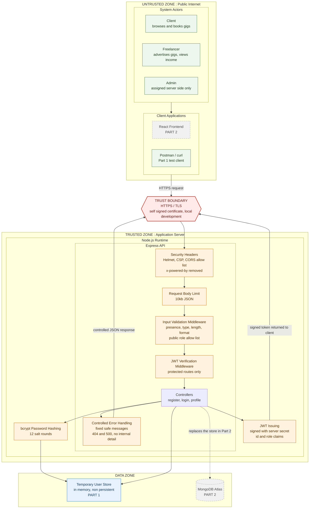
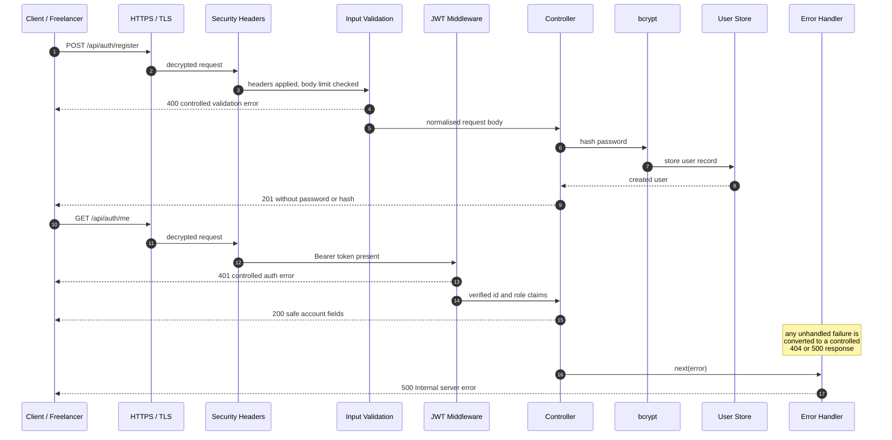

# HustleHub+ System Architecture

This document records the HustleHub+ MERN architecture, its security controls,
and its trust boundaries. Components marked **PART 2** are planned rather than
implemented, and are drawn with a dashed outline.

The diagram source is also available as
[`hustlehub-architecture.mmd`](hustlehub-architecture.mmd).

---

## System Architecture and Trust Boundaries

---

## Legend

| Style | Meaning |
|---|---|
| Green | System actor or client tool |
| Orange | Security control implemented in Part 1 |
| Red | Trust boundary crossing |
| Blue | Data storage |
| Grey, dashed | Planned for Part 2, not yet implemented |

---

## Trust Boundaries

| Boundary | Separates | Control applied at the crossing |
|---|---|---|
| Network boundary | Public internet from the application server | HTTPS/TLS encrypts all traffic. Helmet applies security headers and CORS restricts which browser origin may read responses. |
| Request boundary | Untrusted request data from application logic | Body size limit, then input validation middleware. Malformed or oversized requests are rejected before any controller runs. |
| Identity boundary | Anonymous requests from authenticated ones | JWT verification middleware. Protected routes require a valid signed token before the controller executes. |
| Storage boundary | Application logic from stored credentials | bcrypt hashes every password before storage. Plaintext passwords are never written or returned. |
| Response boundary | Internal failures from client responses | Central error handler replaces every error with a fixed client-safe message. |

---

## Components

### Actors

| Component | Status | Notes |
|---|---|---|
| Client | Part 1 | Registers publicly. Browses and books gigs in later parts. |
| Freelancer | Part 1 | Registers publicly. Advertises gigs and views income in later parts. |
| Admin | Part 1 | Recognised by the system but excluded from the public registration allow-list. Assigned server side only. |

### Presentation

| Component | Status | Notes |
|---|---|---|
| React frontend | Part 2 | Will consume the API over HTTPS. The CORS allow-list and CSP `connect-src` are already configured for its origin. |
| Postman / curl | Part 1 | Current client for functional, negative and security testing. |

### Application

| Component | Status | Notes |
|---|---|---|
| Node.js | Part 1 | Server runtime. |
| Express | Part 1 | Routing, middleware pipeline and request handling. |
| Security headers | Part 1 | Helmet with a Content Security Policy, Cross-Origin Resource Policy, restricted CORS, and removal of the `x-powered-by` header. |
| Request body limit | Part 1 | JSON bodies limited to 10kb. |
| Input validation | Part 1 | Presence, type, length, format and role allow-list checks. Runs before controller logic. |
| JWT | Part 1 | Signed on successful login with id and role claims. Verified on protected routes. |
| bcrypt | Part 1 | Password hashing with 12 salt rounds. |
| Controlled errors | Part 1 | Central error middleware and a controlled unknown-route handler. |

### Data

| Component | Status | Notes |
|---|---|---|
| Temporary user store | Part 1 | In-memory. Non-persistent by design. Cleared when the process restarts. |
| MongoDB Atlas | Part 2 | Will replace the temporary store. Mongoose schemas will add a second validation layer behind the existing middleware. |

---

## Request Pipeline

The order of the middleware chain is itself a security control. Each stage
rejects invalid requests before the next stage runs, so untrusted input never
reaches password hashing or storage.

