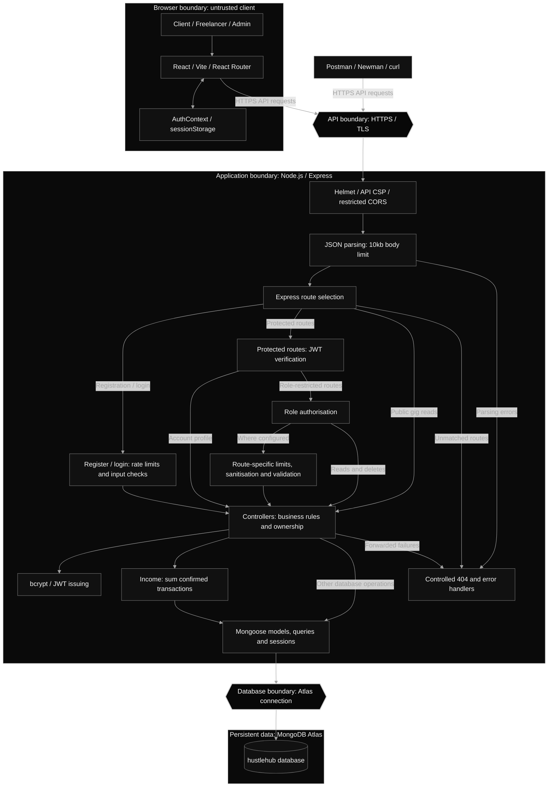
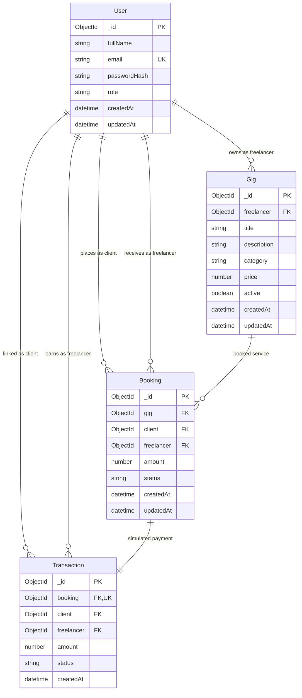
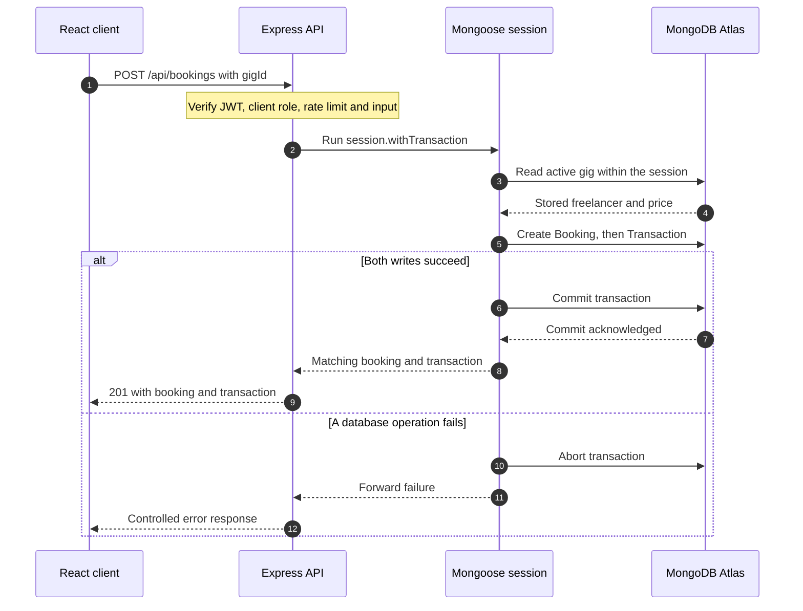

# HustleHub+ System Architecture

**INSY7314 Portfolio of Evidence — Part 2**

HustleHub+ is an implemented MERN freelance marketplace. Clients browse and
book gigs, freelancers manage their own gigs and view bookings and income,
and administrators inspect users and bookings and remove gigs.

React, Express, Mongoose and MongoDB Atlas are implemented components. The
application uses persistent database records instead of the Part 1 in-memory
user store. Payments are simulated; no card details or payment gateway are used.

The main diagram is also available as
[Mermaid source](hustlehub-architecture.mmd).

## System Architecture

The diagram shows component relationships and the main request paths. Middleware
order varies by route; the exact sequences are recorded below. Ownership checks
are performed in controllers and database queries, rather than by a separate
ownership middleware.

All component boxes represent implemented components. Outlined diamonds identify
trust boundary crossings. The browser remains untrusted even after login.

### Local Assessment Configuration

| Setting | Configuration |
|---|---|
| React frontend | `http://localhost:5173`, served by Vite |
| Backend API | `https://localhost:4000` when `USE_HTTPS=true` |
| Allowed browser origin | `CLIENT_ORIGIN`, normally `http://localhost:5173` |
| Frontend API origin | `VITE_API_URL`, normally `https://localhost:4000` |
| Database | MongoDB Atlas, database name `hustlehub` in `MONGO_URI` |
| Local TLS files | Paths supplied through `SSL_KEY_PATH` and `SSL_CERT_PATH` |

The API connects to MongoDB before accepting requests. A missing configuration
or failed database connection prevents startup. The database name comes from
`MONGO_URI`; it is not hard-coded in the connection function. The assessment
connection must select `hustlehub`, not `test`.

The frontend document is served separately from the HTTPS API. Helmet applies
CSP to API responses. **React document CSP is a separate assigned follow-up and
must be verified on the frontend document response.** API CSP does not establish
that the React document has its own policy.

## Components and Responsibilities

| Layer | Implementation | Responsibility |
|---|---|---|
| Presentation | `client/src/App.jsx`, `client/src/pages/`, `client/src/components/` | React screens, forms, marketplace browsing and role-aware navigation. |
| Session | `client/src/context/AuthContext.jsx` | Login state, session restoration, logout and protection against stale asynchronous responses. |
| API transport | `client/src/services/api.js` | Requests to the configured API origin, Bearer tokens, timeouts and safe error messages. |
| Application entry | `api/index.js` | Database-dependent startup, HTTPS, Helmet, CORS, JSON parsing, route mounting and final error handlers. |
| Routes | `api/routes/` | Endpoint definitions and route-specific middleware order. |
| Middleware | `api/middleware/` | JWT verification, role checks, rate limits, input sanitisation and request validation. |
| Controllers | `api/controllers/` | Authentication, gig ownership, bookings, income and administrator operations. |
| Models | `api/models/` | User, Gig, Booking and Transaction schemas, indexes and database operations through Mongoose. |
| Database connection | `api/config/db.js` | Connects Mongoose using the server-side `MONGO_URI`. |
| Authentication utilities | `api/utils/password.js`, `api/utils/token.js` | bcrypt password operations and JWT signing and verification. |

## Trust Boundaries

| Boundary | What crosses it | Controls and responsibility |
|---|---|---|
| Browser to API | Requests, credentials and Bearer JWTs | HTTPS protects API traffic. The backend treats browser state, roles, identifiers and request bodies as untrusted. |
| Browser origin | Cross-origin browser requests | CORS advertises only the configured `CLIENT_ORIGIN`. It restricts browser response access; it does not authenticate callers or prevent direct API requests. |
| Request parsing | JSON body to route logic | The global 10kb limit and controlled JSON parsing run before route-specific middleware. |
| Identity | Bearer token to authenticated identity | `protect` verifies signature and expiry before populating `req.auth`. Missing, malformed, invalid or expired tokens receive `401`. |
| Permission and ownership | Authenticated identity to a protected operation | `authorizeRoles` rejects the wrong role with `403`. Controllers derive ownership from verified identity and constrain database queries. |
| Application to database | Validated queries and writes | Mongoose schemas and indexes provide a further validation layer. Atlas credentials and access configuration stay server-side. Stored user content remains untrusted when displayed. |
| API to browser | Account data, results and errors | Responses explicitly select safe fields. Controlled handlers prevent internal error details from reaching clients. React renders application text through JSX. |

The database connection belongs to the backend. The frontend never receives an
Atlas connection string or connects directly to MongoDB.

## Request Processing

Normal routed requests pass through Helmet, CORS and `express.json` before their
route middleware. CORS preflight requests may be answered before route logic.
Middleware can return a controlled rejection without reaching a controller.

| Operation | Route-specific order after the global middleware |
|---|---|
| Register | Registration limiter → sanitise `fullName` → registration validation → controller. |
| Login | Login limiter → credential validation → controller. |
| Current account | JWT verification → controller lookup of the current user. |
| Public gig reads | Controller, including ObjectId validation for an individual gig. |
| Create or update a gig | JWT verification → freelancer role → sanitise gig text → gig validation → controller. Update ownership is included in the database query. |
| Read or delete own gigs | JWT verification → freelancer role → controller with ownership filters and identifier checks where required. |
| Create a booking | JWT verification → client role → booking limiter → booking validation → controller and database transaction. |
| Read bookings or income | JWT verification → required role → controller with account-scoped queries or aggregation. |
| Administrator operations | JWT verification → admin role → controller, including identifier validation for gig removal. |

Sanitisation removes markup and unsafe control characters from selected
plain-text fields. Validation then checks types, lengths, formats, permitted
roles and fields. Passwords are not altered by text sanitisation. Booking bodies
accept only `gigId`; client, freelancer and amount overrides are rejected.

### Rate Limiting

| Endpoint | Limit | What counts |
|---|---|---|
| `POST /api/auth/register` | 10 requests per hour | Registration attempts. |
| `POST /api/auth/login` | 5 failed requests per 15 minutes | Successful login responses do not consume the allowance. Once exhausted, further attempts are blocked until reset. |
| `POST /api/bookings` | 10 requests per 15 minutes | Attempts that pass JWT and client-role checks, including invalid booking bodies. |

Limiters use the request IP and an in-memory store. They return controlled `429`
responses and standard rate-limit headers. `Retry-After` is exposed through CORS
so the React client can read it. These counters are separate from persistent
application data and reset when the API process restarts.

## API Access and Ownership

| Method and path | Access | Enforcement |
|---|---|---|
| `GET /`, `GET /health` | Public | API information and health response. |
| `POST /api/auth/register` | Public | Registration allows only `client` or `freelancer`. |
| `POST /api/auth/login` | Public | Valid credentials required to issue a JWT. |
| `GET /api/auth/me` | Any authenticated role | Returns safe details for the current database user. |
| `GET /api/gigs`, `GET /api/gigs/:id` | Public | Only active gigs are returned. |
| `GET /api/gigs/mine` | Freelancer | Returns all gigs owned by the authenticated freelancer, including inactive gigs. |
| `POST /api/gigs` | Freelancer | Owner is set from `req.auth.id`. |
| `PUT /api/gigs/:id`, `DELETE /api/gigs/:id` | Freelancer | Query includes both gig ID and authenticated freelancer ID. |
| `POST /api/bookings` | Client | Client comes from the JWT; freelancer and price come from the active gig. |
| `GET /api/bookings/mine` | Client | Query is restricted to the authenticated client. |
| `GET /api/bookings/:id` | Client | Query includes booking ID and authenticated client ID. |
| `GET /api/bookings/freelancer` | Freelancer | Query is restricted to the authenticated freelancer. |
| `GET /api/income/me` | Freelancer | Aggregates only that freelancer's confirmed transactions. |
| `GET /api/admin/users` | Admin | Returns explicitly selected safe account fields. |
| `GET /api/admin/bookings` | Admin | Returns platform booking records. |
| `DELETE /api/admin/gigs/:id` | Admin | May remove a gig regardless of owner. |

Cross-owner gig modification and client booking lookup return `404`, using the
same response as a missing record. Administrator gig deletion is an explicitly
authorised exception to freelancer ownership restrictions. Public registration
cannot create an administrator account.

## Persistent Data Model

The diagram shows the main stored fields and logical relationships. Mongoose
uses ObjectId references; these are not relational foreign-key constraints.
`FK` marks a reference field in this diagram.

`User.role` is `client`, `freelancer` or `admin`. Email is unique, and
`passwordHash` is excluded from ordinary queries. `Transaction.booking` is
unique so a booking cannot have multiple transaction records with that reference.
The one-to-one booking/transaction relationship is established by the creation
workflow, not by a MongoDB foreign-key constraint.

Gig prices and booking amounts use JavaScript/Mongoose numbers. The API gig
validator accepts prices of at least `0.01`, with up to two decimal places and
within the supported safe range. The UI formats amounts in ZAR. A booking stores
the price at booking time; later gig edits do not change historical amounts.

Removing a gig does not delete its bookings or transactions. A historical
booking can therefore retain a reference to a gig that is no longer available.
The client history screen provides fallback text for unavailable gig details.

### Booking and Transaction Consistency

The following sequence assumes that the requested active gig exists. A missing
or inactive gig returns `404` without creating a booking or transaction.

Both records use the authenticated client, the stored gig owner and the stored
gig price. They are created in one database transaction: either both writes
commit or neither persists. Atlas must support the transaction-capable connection
used by Mongoose.

The frontend asks for confirmation and blocks repeated clicks while submitting.
It does not automatically retry a booking request. If the response is lost or
cannot be verified, it directs the client to booking history before another
attempt. Atomic database writes do not by themselves make repeated requests
idempotent.

### Derived Freelancer Income

Income is calculated from `Transaction`, not stored in a separate income
collection. `GET /api/income/me` matches the authenticated freelancer and
`status: confirmed`, sums `amount`, and returns `totalIncome` and
`transactionCount`. The returned total is rounded to two decimal places; no
matching transactions produce a total and count of zero.

Booking and transaction schemas also recognise `cancelled`, but the current
routes do not provide a cancellation workflow. Simulated income is not an
external payment settlement or a tax calculation.

## Frontend and Backend Security Responsibilities

| Frontend responsibility | Backend responsibility |
|---|---|
| Display routes and actions appropriate to the current role. | Independently verify JWTs and enforce roles on protected endpoints. |
| Validate forms for immediate feedback. | Validate every API request, including requests made outside React. |
| Store the JWT in tab-scoped `sessionStorage` and restore through `/api/auth/me`. | Verify JWT signature and expiry, and return current safe account details from `/me`. |
| Send only a gig ID when booking. | Derive client, freelancer and amount from trusted server-side sources. |
| Prevent accidental repeated submissions and display safe errors. | Apply rate limits, ownership filters and atomic booking/transaction writes. |
| Render application text through JSX and apply document CSP through the frontend server configuration. | Sanitise selected input fields and apply Helmet/CSP to API responses. |

React `ProtectedRoute` controls navigation; it is not an authorisation boundary.
The protected pages are `/bookings` for clients, `/freelancer/gigs` and
`/freelancer/dashboard` for freelancers, and `/admin` for administrators.
`/gigs` is public, while `/login` and `/register` use guest-route handling.

Session restoration does not trust a role saved in browser storage. It calls
`/api/auth/me` and keeps protected content hidden while restoring or during an
API outage. A `401` clears the saved session. Logout clears browser session state;
it does not revoke an already issued JWT on the server. JWT expiry defaults to
one hour and is configurable through `JWT_EXPIRES_IN`.

The API transport restricts requests to `VITE_API_URL`, omits cookies, rejects
redirects and applies a 15-second timeout. API error messages are bounded, and
server failures are shown as generic availability messages.

## Credentials and Controlled Responses

Passwords are hashed with bcrypt before database storage. The work factor is
configured through `BCRYPT_SALT_ROUNDS`, with a default of 12 and a minimum
accepted configuration of 10. Login explicitly selects the hash for comparison;
ordinary account responses exclude it.

JWT application claims contain the user's ID and role, with library-generated
timing claims. The signing secret stays on the backend. Login intentionally
returns the token to its authenticated caller; account and administrator
responses do not return passwords, password hashes or configuration secrets.

Unknown routes that reach the final route handler receive controlled `404`
JSON. Invalid input, unauthorised requests, duplicate registration, oversized
bodies and rate limits receive controlled client errors. Forwarded unexpected
failures return a generic `500` response; diagnostic details remain server-side.

## Verification and Part 2 Scope

| Verification layer | Existing project location | Purpose |
|---|---|---|
| API regression | `postman/postman_collection.json`, `postman/postman_environment.json` | Success, failure, role, ownership and security scenarios executed through Postman/Newman. |
| React automation | `client/src/test/` | Rendering, interaction and API-transport checks using Vitest, Testing Library and jsdom. |
| Execution reports | `evidence/part2/newman-report.xml`, `evidence/part2/react-tests.xml` | Stored test results; final evidence must correspond to the assessed revision. |
| Runtime evidence | Issue #39 review and Issue #41 evidence | Browser workflows, Atlas persistence, HTTPS headers and negative security checks. |

Frontend automated tests mock API responses; they do not replace live backend
or MongoDB verification. Dependency audit results are recorded separately from
functional test results. Startup, credentials and test commands belong in the
repository README.

This architecture covers the Part 2 marketplace, simulated transactions and
freelancer income. Tax estimation, charts, Docker, CI/CD and cloud monitoring
are outside this milestone.